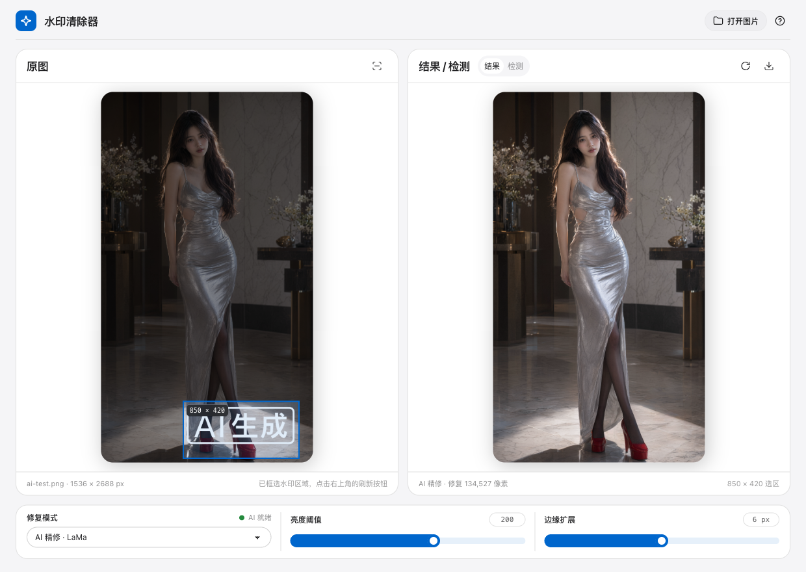

# 水印清除器

一个本地运行的 Web 小工具和 macOS 桌面应用：上传图片，用鼠标框出水印区域，自动识别浅色水印像素，默认使用 LaMa AI 精修，也可切换到快速的 OpenCV 修复。

图片只发送到本机服务，不经过第三方。Web 版和桌面版共用同一套 FastAPI + HTML/CSS/JS 界面。



*macOS 桌面模式。原生窗口标题栏由 macOS 提供，不包含在网页截图中。*

## Web 版

需要 Python 3.12+ 和 [uv](https://docs.astral.sh/uv/)。

```bash
uv sync
uv run oma-watermark
```

打开 <http://127.0.0.1:8000>。

### 可选：安装 AI 精修模型

快速模式不需要模型。AI 模式使用 [OpenCV 官方 LaMa ONNX 模型](https://huggingface.co/opencv/inpainting_lama)（约 93 MB），只需下载一次：

```bash
uv run oma-watermark-download-model
```

下载命令使用项目依赖中的 Hugging Face CLI（`uv sync` 已安装）。如果 Hugging Face 无法访问，先设置代理再运行：

```bash
export https_proxy=http://127.0.0.1:7897
export http_proxy=http://127.0.0.1:7897
export all_proxy=socks5://127.0.0.1:7897
uv run oma-watermark-download-model
```

也可以直接用 `hf`：

```bash
uv run hf download opencv/inpainting_lama inpainting_lama_2025jan.onnx --local-dir models
```

默认路径是 `models/inpainting_lama_2025jan.onnx`。如需放到别处：

```bash
OMA_LAMA_MODEL=/path/to/inpainting_lama_2025jan.onnx uv run oma-watermark
```

模型文件不提交到仓库，`models/` 已加入 `.gitignore`。模型采用 Apache-2.0 许可。

## macOS 桌面应用

桌面版使用 [pywebview](https://pywebview.flowrl.com/) 的 WKWebView + pywebview 原生窗口，后端仍是本机 FastAPI；通过 PyInstaller 打包为 `.app`，再生成 DMG。

### 直接安装

从 GitHub Releases 下载 `Watermark-Remover-*.dmg`，打开后把「水印清除器」拖入 Applications。

DMG 内置 LaMa 模型，AI 模式可离线使用。当前构建是 **ad-hoc 签名、未公证**，首次打开可能需要：

- 右键 App →「打开」；或
- `xattr -dr com.apple.quarantine "/Applications/Watermark Remover.app"`

正式分发建议配置 Apple Developer ID 证书和 notarization。

### 本地运行桌面模式

```bash
npm ci
npm run build:css
uv sync --extra desktop
uv run oma-watermark-desktop
```

桌面模式使用 macOS 原生窗口标题栏，页面顶部只保留紧凑工具栏。默认窗口 1240×880，最小尺寸约 980×780；桌面窗口隐藏页面滚动条，使用说明放在工具栏的「?」帮助弹窗。

### 本地构建 DMG

```bash
bash packaging/build_macos.sh
```

构建脚本会：

1. 检查并下载 LaMa 模型；
2. 构建本地 Tailwind/daisyUI CSS；
3. 使用 PyInstaller 生成 `Watermark Remover.app`；
4. ad-hoc 签名；
5. 生成带 Applications 快捷方式的 `dist/Watermark-Remover-<version>-<arch>.dmg`。

可通过 `OMA_APP_VERSION=0.2.0` 指定版本号。

### GitHub Actions

[`.github/workflows/build-desktop.yml`](.github/workflows/build-desktop.yml) 支持：

- 手动触发 `workflow_dispatch`
- 推送 `v*` tag 时自动构建并创建 GitHub Release
- macOS `macos-14`（Apple Silicon arm64）生成 DMG
- Windows `windows-latest` 生成 ZIP（可选，失败不阻塞 macOS 构建）
- 缓存 LaMa 模型，避免每次重复下载

## Windows（可选）

```powershell
npm ci
npm run build:css
uv sync --extra desktop
powershell -ExecutionPolicy Bypass -File packaging/build_windows.ps1
```

产物为 `dist/Watermark-Remover-<version>-windows.zip`。Windows 版使用 WebView2，Windows 10/11 通常已预装；没有安装时需安装 Microsoft Edge WebView2 Runtime。

## 使用步骤

1. 拖入或选择一张图片（PNG / JPEG / WebP / BMP，≤ 25 MB）。
2. 在原图上拖动鼠标，框出一个包含水印的矩形。
3. 默认使用 **AI 精修 · LaMa**；模型不可用时会自动回退到 **快速 · OpenCV**。
   - **AI 精修 · LaMa**：需要模型，CPU 推理约 3–4 秒（首次加载模型约 8 秒），更擅长恢复纹理、鞋履、地面、衣物等复杂背景。
   - **快速 · OpenCV**：无需模型，约 0.1 秒，适合纯色/简单背景；修复区域偏平滑。
4. 按需调整「亮度阈值」和「边缘扩展」。
5. 点击结果面板右上角的开始图标；处理完成后可在「结果 / 检测」之间切换，点击下载图标保存。需要重做时，点击同一位置的刷新图标。

### 参数说明

- **亮度阈值**：B/G/R 三个通道都高于该值的像素会被当作水印。水印没清干净就调低，误选背景就调高。
- **边缘扩展**：mask 向外扩展的像素数。调大能覆盖白边、阴影和抗锯齿，但修复区域更大；调小更清晰，但可能残留水印边缘。默认 6px。

## 实现方式

1. 前端把原图、ROI、阈值、扩展值和模式发送到 `POST /api/remove`。
2. 服务端在 ROI 内用 `cv2.inRange` 选中所有通道亮度都高于阈值的像素。
3. 按「边缘扩展」对 mask 做形态学膨胀。
4. 根据模式修复：
   - **快速**：`cv2.inpaint(..., cv2.INPAINT_TELEA)`。
   - **AI**：裁出 mask 周围的正方形区域，缩放至 512×512，通过 OpenCV DNN 跑 LaMa，再把 mask 内的像素贴回原图。
5. 返回结果图、红色检测区预览和修复像素数。

核心代码：

- [`src/oma_watermark/core.py`](src/oma_watermark/core.py)：mask 与快速修复
- [`src/oma_watermark/lama.py`](src/oma_watermark/lama.py)：LaMa 模型与 AI 推理
- [`src/oma_watermark/app.py`](src/oma_watermark/app.py)：FastAPI 与静态资源
- [`src/oma_watermark/desktop.py`](src/oma_watermark/desktop.py)：桌面窗口与本地服务生命周期
- [`src/oma_watermark/static/`](src/oma_watermark/static/)：Web UI
- [`packaging/`](packaging/)：PyInstaller spec、图标与 DMG/Windows 构建脚本

## UI 与 Apple 主题

- 使用 [`DESIGN.md`](DESIGN.md) 中的 Apple 设计语言：Action Blue、Parchment 背景、18px 卡片圆角、胶囊按钮、细描边、无装饰阴影。
- daisyUI 主题沉淀在 [`src/oma_watermark/static/app.css`](src/oma_watermark/static/app.css)，通过 `@plugin "daisyui/theme"` 定义 `apple` 和 `apple-dark`，跟随系统浅色/深色模式。
- 修改 UI 后重新生成 CSS：

```bash
npm run build:css
```

- 生成的文件是 `src/oma_watermark/static/app.built.css`。应用不再依赖 daisyUI CDN，可完全离线运行。
- 桌面模式通过 `?desktop=1` 使用原生标题栏和全高布局，隐藏页面滚动条。

## 测试

```bash
uv run pytest
```

测试覆盖 ROI 校验、mask 生成、边缘扩展、修复范围、API 成功与错误路径，以及 AI 模式缺少模型时的错误处理。下载模型后，本地测试还会运行一次 LaMa 冒烟测试；没有模型时该测试自动跳过。

## MVP 边界

- 只处理**浅色/白色**水印；深色水印需要另做检测策略。
- 单张图片、单个矩形选区；没有自动检测、批量处理或画笔 mask。
- 快速模式是扩散式内容填充，修复区域会变平滑，复杂纹理上尤其明显。
- AI 模式受 512×512 模型输入限制；大选区会被缩放，结果可能更柔和，也可能会“脑补”背景。
- 透明 PNG 会先合成到白底，输出不保留 alpha。
- macOS DMG 为 ad-hoc 签名、未公证；正式分发需要 Developer ID。
- Windows 构建为 ZIP，不是安装器；依赖 WebView2。
- 图片在内存中处理，不落盘、不保存历史。

## API

`POST /api/remove`（multipart/form-data）

| 字段 | 类型 | 说明 |
| --- | --- | --- |
| `file` | file | 原图 |
| `x`, `y` | int | ROI 左上角 |
| `width`, `height` | int | ROI 尺寸 |
| `threshold` | int | 亮度阈值，默认 200 |
| `expand` | int | 边缘扩展像素，0–12，默认 6 |
| `mode` | string | `ai`（默认）或 `fast` |

返回 JSON：`result`、`mask_overlay`（data URL）、`filename`、尺寸、`detected_pixels`、`mode`、`expand`、`roi`。

`GET /api/health` 返回 `status`、`ai_available` 和 `ai_engine`，用于前端显示模型是否就绪。
